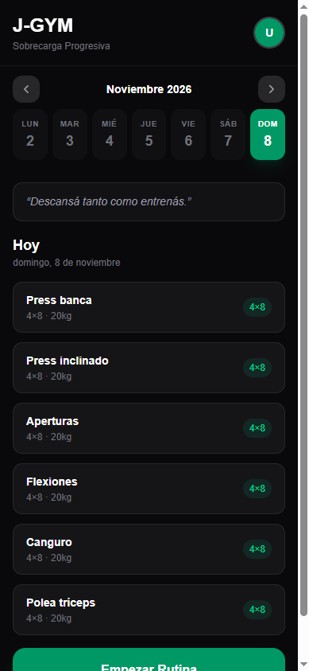
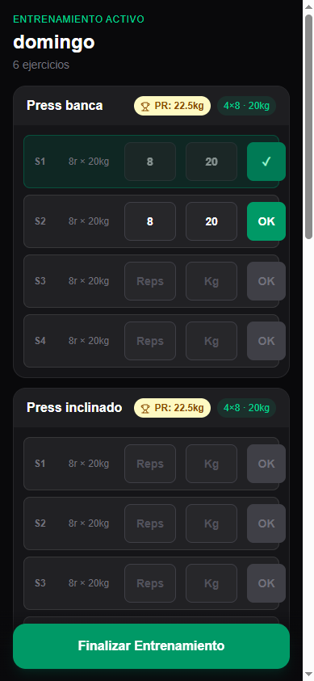

# J-GYM

Mobile-first workout tracker (PWA) that applies **progressive overload** automatically: you log your sets, it decides next week's scheme.

**Live:** https://juangym.vercel.app · press **"Probar demo sin registrarte"** to try it without an account.

The UI is in Spanish.

<p align="center">
  
  &nbsp;&nbsp;
  
</p>

## Features

- **Sign in** with an email magic link, or start an anonymous demo session.
- **Onboarding:** pick your training days, start from a default routine or build your own.
- **Weekly calendar** with the routine of the day and a motivational quote on rest days.
- **Workout session:** log reps and weight per set, then finish to save an immutable log.
- **Personal records** detected when a session beats your previous best weight.
- **Progressive overload engine** updates the next session's scheme from your performance.
- **Installable PWA** (manifest + service worker).

### Overload rule (Standard Hypertrophy)

| Current scheme | Result | Next scheme |
|---|---|---|
| 3x12 | All reps completed | 4x8, same weight |
| 4x8 | Reaches 4x12 | 3x8 with a weight increase entered by the user |
| Any | Misses the minimum reps | Keep the current scheme |

Weight increases are always entered by the user; the app never suggests a weight.

## Stack

Next.js 16 (App Router) · React 19 · TypeScript (strict) · Tailwind CSS 4 · Zustand · Supabase (Postgres, Auth, Row Level Security) · next-pwa · Jest · GitHub Actions · Vercel.

## Architecture

Clean Architecture, with dependencies pointing inwards:

```
src/
├── core/            Pure business logic, no framework imports
│   ├── domain/      Entities and pure helpers
│   ├── strategies/  Overload algorithms (Strategy pattern)
│   ├── use-cases/   evaluate-overload, detect-personal-records
│   └── constants/   Default routines, quotes
├── infrastructure/  Adapters: Supabase repositories (Repository pattern) and auth clients
├── presentation/    React components and Zustand stores
├── app/             Routes
└── proxy.ts         Route protection (Next 16 proxy)
```

Every table has Row Level Security: users only read and write their own rows (`auth.uid() = user_id`), including anonymous demo users. Schema: [`supabase/migrations/0001_init.sql`](supabase/migrations/0001_init.sql).

## Run locally

Requirements: Node 20+ and a Supabase project (the free tier works).

1. In Supabase, open the SQL editor and run `supabase/migrations/0001_init.sql` (it is idempotent).
2. In **Authentication**, enable the Email provider and **anonymous sign-ins**, and add `http://localhost:3000/auth/callback` to the redirect URLs.
3. Configure and start:

```bash
cp .env.example .env.local   # fill in the project URL and anon key
npm install
npm run dev
```

Open http://localhost:3000.

## Scripts

| Script | What it does |
|---|---|
| `npm run dev` | Development server (PWA disabled in dev) |
| `npm run build` | Production build (`--webpack`, required by next-pwa) |
| `npm run lint` | ESLint |
| `npm run typecheck` | TypeScript, no emit |
| `npm test` | Jest unit tests for `src/core` |

CI runs lint, typecheck, tests and build on every push and pull request to `main`.

## Roadmap

- Push notification reminders on training days (needs a sender and subscription storage).
- Google sign-in.

## Author

Juan Saracco · [GitHub](https://github.com/saracco-juan)
