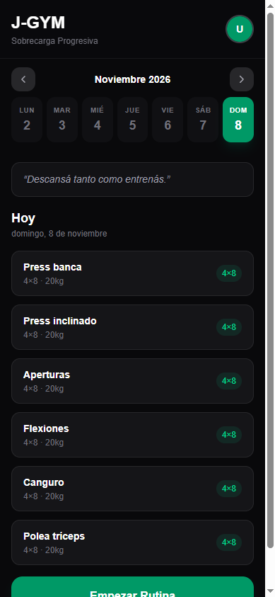
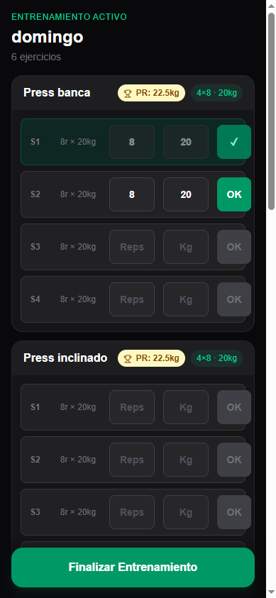

# J-GYM

Mobile-first workout tracker (PWA) that applies **progressive overload** automatically: you log your sets, it decides next week's scheme.

**Live:** https://juangym.vercel.app · sign in with your email, no password.

The UI is in Spanish.

<p align="center">
  
  &nbsp;&nbsp;
  
</p>

## Features

- **Sign in** with a code sent by email (typed inside the app, so it works in the installed PWA). No password and no link.
- **Profile:** a display name and an avatar color, shown as initials in the header. Accounts created with the old anonymous demo link an email first and keep all their data.
- **Gym table** (`/leaderboard`): every registered user with a profile is ranked by streak, weekly volume or progress of the month, with level, status and achievements on a card. Each device computes its own stats from local data and publishes one snapshot; offline it shows the last board it saw. The numbers are self reported and only describe what happened: the app never suggests a weight.
- **Onboarding:** pick your training days, start from a default routine or build your own.
- **Weekly calendar** with the routine of the day and a motivational quote on rest days.
- **Swap days this week** (`/routine`, "Esta semana"): trade the routines of two days of the current week, for example Legs on Monday and Cardio on Tuesday, or move a routine to a rest day (Tuesday's routine done on Friday). Two rest days cannot be swapped. Only days from today on, with no workout logged, can be swapped, and not today while a workout is in progress. Next week goes back to the normal routine on its own. The streak and the "full week" achievements follow the swap: they read the routine each date showed. Swaps are kept after their week and sync to Supabase (`day_overrides`, migration `0007`), so every device computes the same stats.
- **Workout session:** log reps and weight per set, then finish to save an immutable log.
- **Personal records** detected when a session beats your previous best weight.
- **Progressive overload engine** updates the next session's scheme from your performance.
- **Installable PWA that works offline:** after one online visit the app opens and navigates (dashboard, workout, onboarding) with no signal. Data is stored on the device first and syncs automatically when the connection returns. Screens never opened online show a "Sin conexión" page.

### Overload rule (Standard Hypertrophy)

| Current scheme | Result | Next scheme |
|---|---|---|
| 3x12 | All reps completed | 4x8, same weight |
| 4x8 | Reaches 4x12 | 3x8 with a weight increase entered by the user |
| Any | Misses the minimum reps | Keep the current scheme |

Weight increases are always entered by the user; the app never suggests a weight.

## Stack

Next.js 16 (App Router) · React 19 · TypeScript (strict) · Tailwind CSS 4 · Zustand · Supabase (Postgres, Auth, Row Level Security) · Serwist (service worker) · Jest · GitHub Actions · Vercel.

## Architecture

Clean Architecture, with dependencies pointing inwards:

```
src/
├── core/            Pure business logic, no framework imports
│   ├── domain/      Entities and pure helpers
│   ├── strategies/  Overload algorithms (Strategy pattern)
│   ├── use-cases/   evaluate-overload, detect-personal-records
│   ├── stats/       Streak, XP and level, status and achievements (the public snapshot)
│   ├── leaderboard/ Ranking, stale value rules and number formats
│   └── constants/   Default routines, quotes
├── infrastructure/  Adapters: Supabase repositories (Repository pattern) and auth clients
├── presentation/    React components and Zustand stores
├── app/             Routes
└── proxy.ts         Route protection (Next 16 proxy)
```

Every table has Row Level Security: users only read and write their own rows (`auth.uid() = user_id`). The exceptions are `profiles` and `public_stats`: every registered (non anonymous) user can read all of them, because the leaderboard shows them, but only writes their own (and `public_stats` only once a profile exists). Schema: [`supabase/migrations/0001_init.sql`](supabase/migrations/0001_init.sql) and the later migrations.

## Run locally

Requirements: Node 20+ and a Supabase project (the free tier works).

1. In Supabase, open the SQL editor and run the files in `supabase/migrations/` in order (each one is idempotent):

   | File | Adds |
   |---|---|
   | `0001_init.sql` | routine templates and workout logs |
   | `0002_offline_sync.sql` | custom exercises and the columns the sync engine needs |
   | `0003_keep_alive.sql` | the heartbeat that the daily `keep-alive` workflow writes so the Free project is not paused |
   | `0004_profiles.sql` | `profiles` (display name and avatar color) with its Row Level Security |
   | `0005_public_stats.sql` | `public_stats` (the snapshot each user publishes for the leaderboard) with its Row Level Security |
   | `0006_delete_account.sql` | `delete_own_account()`, the function behind "Eliminar cuenta" |
   | `0007_day_overrides.sql` | `day_overrides` (the days swapped in "Esta semana", synced so every device reads the same schedule) with its Row Level Security |

   Run `0007` before deploying the version that syncs swapped days. Without the table the swaps still work on the device, but their writes wait in the outbox, retrying, until it exists.

2. Set up the email code login (see **Authentication** below).
3. Configure and start:

```bash
cp .env.example .env.local   # fill in the project URL and anon key
npm install
npm run dev
```

Open http://localhost:3000.

## Authentication

Login is an email one-time code: the app asks for the email, Supabase sends a code, the user types it. There is no link to open, which matters in the installed iOS PWA (a link would open Safari instead of the app).

1. **Custom SMTP is required.** Supabase's built-in mailer is limited to a couple of emails per hour, which is not usable for login. In **Authentication > Emails > SMTP settings**, configure your own SMTP provider.
2. In **Authentication > Providers**, enable the **Email** provider.
3. In **Authentication > Email Templates**, edit these two templates so the email contains the code (`{{ .Token }}`) and not only a link:
   - **Magic Link** (used by login): for example `Tu código de acceso es: {{ .Token }}`.
   - **Change Email Address** (used when an anonymous account links an email): for example `Tu código para vincular el email es: {{ .Token }}`.
4. The code has 6 digits by default. **Email OTP Length** (Authentication > Providers > Email) can be raised up to 10; the app accepts 6 to 10 digits, so changing it needs no deploy.
5. Login no longer uses links, so no redirect URL is required. The `/auth/callback` route stays only so magic links sent earlier keep working.

**Anonymous accounts.** The old "Probar demo" button created anonymous users. They keep working: a banner on the dashboard and an item in the profile menu let them link an email (`updateUser({ email })` plus the code, verified with `type: "email_change"`). It is the same user id, so every row stays. Profiles require a linked email.

Once every anonymous account that matters has linked an email, turn **Allow anonymous sign-ins** off in **Authentication > Sign In / Providers**. The app has no code path that creates anonymous users anymore.

## Account

Two actions in the profile menu, both behind a confirmation sheet:

- **Reiniciar datos** keeps the account, the name and the color. It deletes the routine, the workouts, the custom exercises, the swapped days and the unfinished session on the device and queues the matching deletes in the outbox, so it works offline. A fresh empty stats snapshot is published so the leaderboard stops showing the old numbers. It is blocked while a workout is in progress. Other devices keep their local copy until they reset too.
- **Eliminar cuenta** needs a connection and the word `ELIMINAR` typed. It calls the `delete_own_account()` RPC (migration `0006`), which deletes the row in `auth.users`; every user table references it with `ON DELETE CASCADE`, so routines, workouts, custom exercises, profile and stats go with it, and Supabase removes the sessions and refresh tokens. If the call fails nothing is deleted locally. On success the device is wiped (data, outbox, profile, stats cache) and the app returns to `/login`. A JWT already issued stays valid until it expires, but a deleted user has no rows left for it to reach. Deleting a user that owns Storage objects is refused by Supabase; the app stores none.

## Scripts

| Script | What it does |
|---|---|
| `npm run dev` | Development server (PWA disabled in dev) |
| `npm run build` | Production build (`--webpack`, required by Serwist) |
| `npm run lint` | ESLint |
| `npm run typecheck` | TypeScript, no emit |
| `npm test` | Jest unit tests for `src/core` |

CI runs lint, typecheck, tests and build on every push and pull request to `main`.

## Roadmap

- Push notification reminders on training days (needs a sender and subscription storage).
- Google sign-in.

## Author

Juan Saracco · [GitHub](https://github.com/saracco-juan)
